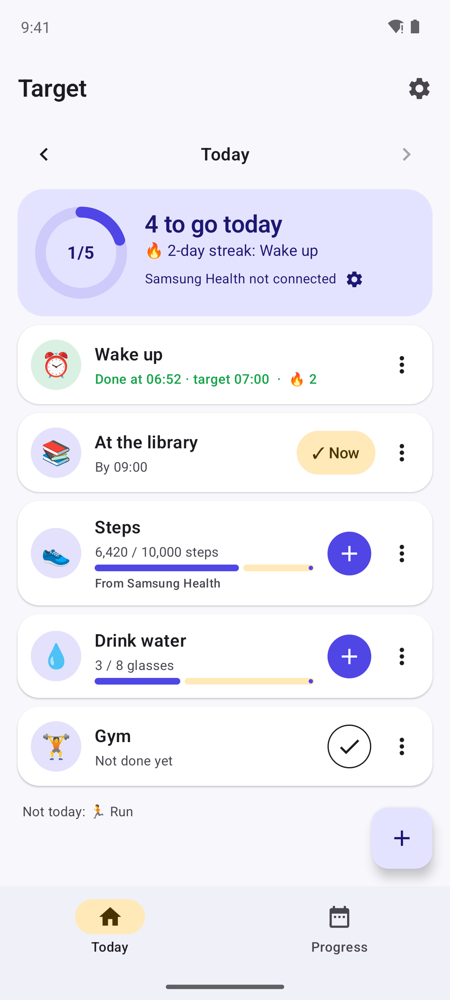
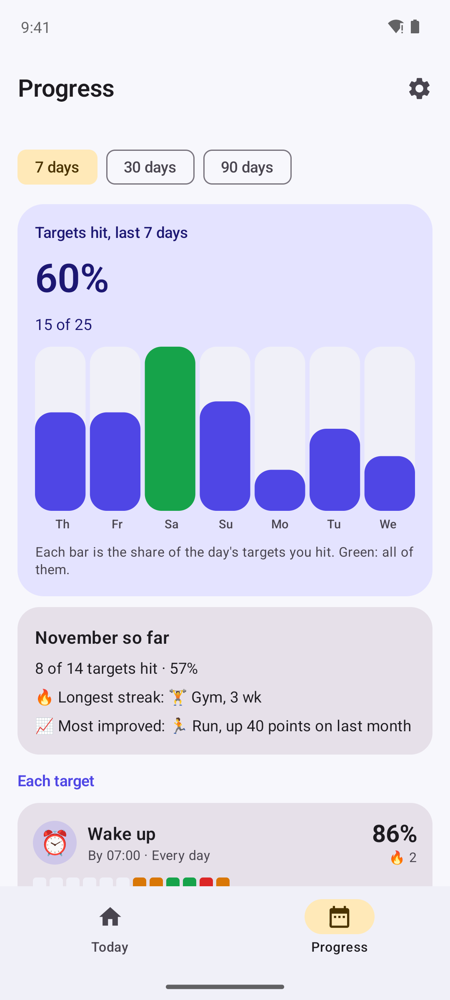
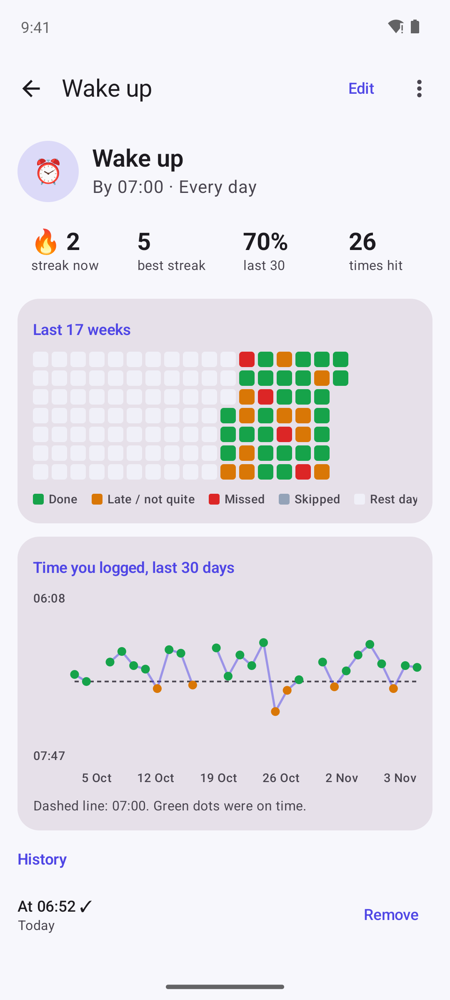
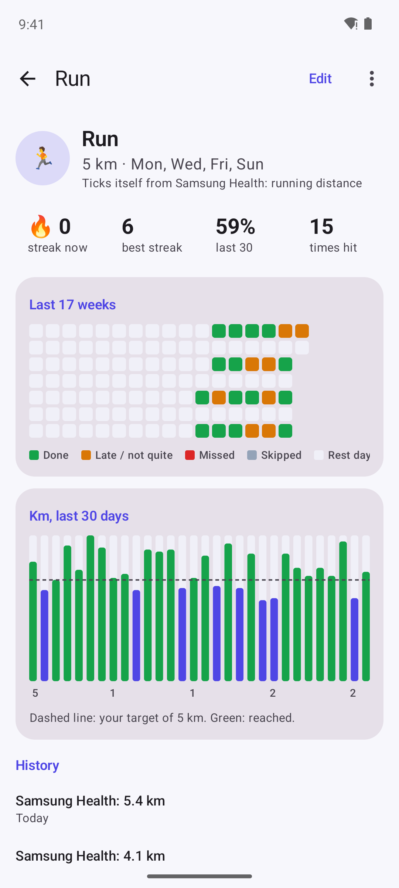

# Target – Habit & Goal Tracker

**An offline habit and goal tracker for Android and iPhone. Set daily targets, log them with a tap, and see how often you hit them.**

🌐 **[rachitratnammudaliar.github.io/Target-Habit-Goal-Tracker](https://rachitratnammudaliar.github.io/Target-Habit-Goal-Tracker/)**

Wake up by 7:00. At the library by 9:00. Run 5 km. 10,000 steps. Target is for **physical daily targets**, not to-do lists: each day every target is hit, late, missed or skipped, and charts show your streaks and hit rate. On Android, **Samsung Health ticks your fitness targets for you**. Your data never leaves your phone: no internet, no account, no ads and no tracking.

  
  
  
  

## Install

Download from **[Releases](../../releases/latest)**. Target isn't in an app store yet, so your phone asks you to confirm the first time.

| Device | File | Requires |
|---|---|---|
| Android | `Target-x.y.z-Android.apk` | Android 8.0+ |
| iPhone, iPad | `Target-x.y.z-iOS.ipa` | iOS 16+, installed with a sideloading tool |

<b>Android</b>

1. Download the APK on your phone and open it. If Android asks, allow your browser or Files app to **install unknown apps**.
2. If Play Protect warns about an unknown developer, tap **More details → Install anyway**.
3. **Samsung Galaxy (One UI 6+):** if the install is blocked, turn off **Settings → Security and privacy → Auto Blocker**, install, then turn it back on.

Updates install over the old version and keep your data.

<b>iPhone and iPad</b>

1. On a Windows PC or Mac, install **[Sideloadly](https://sideloadly.io)** or **[AltStore](https://altstore.io)**.
2. Connect your iPhone, drag in `Target-x.y.z-iOS.ipa`, and sign in with your Apple ID.
3. On the iPhone, open **Settings → General → VPN & Device Management**, tap your Apple ID and choose **Trust**. Also turn on **Settings → Privacy & Security → Developer Mode**.

With a free Apple ID the app must be refreshed every 7 days (AltStore does this automatically).

## Connect Samsung Health (Android)

Samsung Health shares your data with **Health Connect**, which is built into Android and works on the phone, without the internet. Target reads it from there.

1. In **Samsung Health**, open **Settings → Health Connect** and allow it to share steps, exercise, distance and calories.
2. In **Target**, open **Settings → Samsung Health → Connect** and allow the four items.
3. Create a target with an amount, like **Run 10 km**, and choose **Fill in from Samsung Health → Running distance**.

When Samsung Health records your run, the target ticks itself. It syncs when you open the app, and with the refresh button.

| Fills in | From |
|---|---|
| Steps | Daily step count |
| Walking and running distance | All distance for the day |
| Running distance | Distance during running workouts only |
| Active time | Minutes of workouts |
| Active calories | Calories burned by activity |

Target only **reads**; it never writes to Samsung Health or sends anything anywhere. On iPhone, everything is logged by hand.

## Features

**Three kinds of target**
| Kind | For | Logged by |
|---|---|---|
| **Done or not** | Gym, meditate | Tapping ✓ |
| **By a time** | Wake up by 7:00, at the library by 9:00 | Tapping **✓ Now**, which saves the time; on time or earlier is a hit, after is late |
| **An amount** | Run 5 km, 10,000 steps, 8 glasses of water, 20 pages | **＋** adds your usual amount, or Samsung Health fills it in |

**Today**
- A ring with how many of today's targets you've hit, and your longest streak
- One tap to log, with Undo; ‹ › to fill in earlier days
- **Which days:** every day, weekdays, weekends or any days you choose. Other days are rest days that never break a streak
- **Skip** a day when you're ill or travelling, so it doesn't count against you

**Progress**
- Hit rate for the last 7, 30 or 90 days, with a bar for every day (green when every target was hit)
- A calendar heatmap for each target: done, late or not quite, missed, skipped, rest day

**Each target**
- Current and best streak, 30-day hit rate, times hit
- A 17-week heatmap
- A chart of your **wake-up times** against the target time, your **daily km or steps** against the goal, or **times done each week**
- Full history, and Stop tracking to keep the history without the target

**Backup:** export to a file and import it on a new phone, Android or iPhone.

## Privacy

| | |
|---|---|
| Internet | None. The Android build fails if the app ever asks for internet access |
| Storage | Only on your phone, excluded from cloud backups |
| Health data | Read-only, through Health Connect on the phone, only to tick your targets |

See [PRIVACY.md](PRIVACY.md).

## How it's built

| Platform | Built with |
|---|---|
| Android | Kotlin, Jetpack Compose, Material 3, Room, Health Connect |
| iPhone, iPad | Swift, SwiftUI and Swift Charts, a port of the same logic with the same unit tests |

Unit tests cover results, on-time and late, amounts from Samsung Health and by hand, rest days, skips, streaks, hit rates and backups, for Android and on an iPhone simulator, for every change. Screenshots are taken by GitHub Actions on an Android emulator.

## Licence

MIT © 2026 Rachit Ratnam Mudaliar
